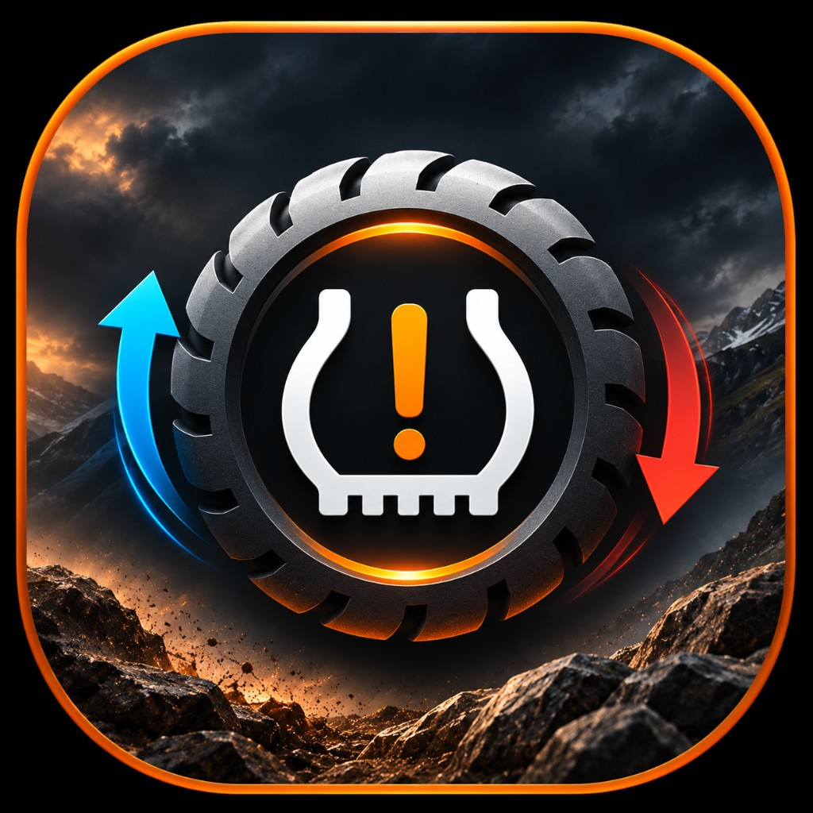
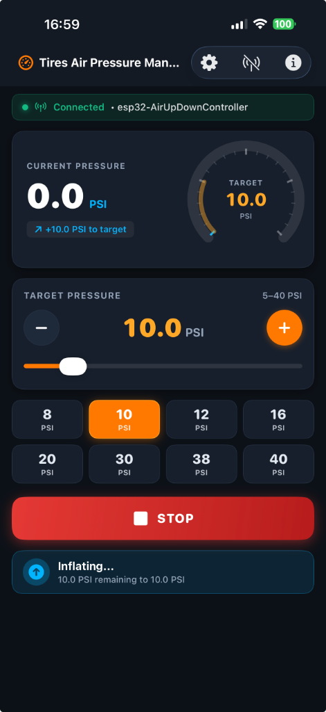

# Tires air pressure

<p align="center">
  
</p>

A small air system that sets tire pressure from a phone. One ESP32 controller sits on a shared air manifold. The Android and iOS apps connect to it over Bluetooth and tell it to inflate or deflate until the tires reach a target pressure.

<p align="center">
  
  &nbsp;&nbsp;&nbsp;&nbsp;
  
</p>

## How it fits together

```text
air tank ── inflate valve ──┐
                            ├── manifold ── four tires
atmosphere ◄── deflate valve ┘
                            └── pressure sensor
                                    │
                                 ESP32
                                    │  BLE
                         Android app    iOS app
                         Android Auto   CarPlay
```

The manifold is one shared volume, so every tire and the sensor see the same pressure. The inflate valve lets air in from the tank. The deflate valve vents air out. With both valves closed, the manifold holds pressure. The controller runs only one valve at a time and keeps both closed until the sensor's full-scale PSI is set.

The phone is the remote control. It shows live pressure, sends inflate, deflate, and stop, and stores target presets. The same actions are available on Android Auto and CarPlay. Both apps speak the same BLE messages, so either phone can run and fully configure the same controller (including GPIO pins, sensor calibration, safety limits, Wi-Fi SSID scanning, hotspot password, and BLE access code).

## Repositories

This repository is only the index. Each part has its own repository, checked out here as a submodule.

| Folder | What it is | Repository |
|---|---|---|
| [`ble`](ble) | ESP32 firmware (`v1.0`), Web UI, wiring, and BLE protocol | [AirUpDownControllerV2](https://github.com/nir-azulay/AirUpDownControllerV2) |
| [`android`](android) | Android phone app (`v2.1.0`) and Android Auto | [TiresAirPressure-Android](https://github.com/nir-azulay/TiresAirPressure-Android) |
| [`ios`](ios) | iOS phone app (`v2.1.0`) and CarPlay | [TiresAirPressure-iOS](https://github.com/nir-azulay/TiresAirPressure-iOS) |

Deeper detail lives next to the code:

- **Full Reverse-Engineered System Specification:** [SPECIFICATION.md](SPECIFICATION.md)
- Controller hardware and air path: [ble/docs/HARDWARE.md](ble/docs/HARDWARE.md)
- Parts list: [ble/docs/PARTS.md](ble/docs/PARTS.md)
- BLE messages: [ble/docs/BLE_PROTOCOL.md](ble/docs/BLE_PROTOCOL.md)
- Schematic: [ble/hardware/AirUpDownController.sch](ble/hardware/AirUpDownController.sch)

## The three parts

**Controller (`v1.0`).** An ESP32 with two onboard relays drives 12 V solenoid valves. By default, the inflate relay is GPIO16, the deflate relay is GPIO17 (both active high), and the pressure sensor is on GPIO34 (all configurable via the Web UI or mobile apps). Firmware is Arduino on PlatformIO, board `esp32dev`. It also serves a responsive offline-capable configuration and OTA update site over Wi-Fi (or fallback SoftAP).

**Android.** A Kotlin and Jetpack Compose app. It scans for the controller, reconnects to the last one, shows the live pressure, and runs inflate and deflate to a target. Android Auto has the same controls for use in the car. Play releases go to the internal testing track.

**iOS.** The same product in SwiftUI, in English and Hebrew, for iPhone and iPad. CarPlay has the in-car controls. TestFlight is the test release.

## Working on it

Clone the parent and the three submodules together:

```bash
git clone --recurse-submodules git@github.com:nir-azulay/TiresAirPressure.git
```

If the parent is already cloned:

```bash
git submodule update --init --recursive
```

Change and push inside the folder you edited (`ble`, `android`, or `ios`). Commit in the parent only when it should record a new submodule commit.

Build and release from the repository that owns that part:

| Part | Build | Test release |
|---|---|---|
| Controller | `pio run -e esp32` in `ble` | Flash from PlatformIO. There is no store release. |
| Android | `./gradlew bundleRelease` in `android` | GitHub Actions workflow **Android Play internal**, on the 1st of the month at 06:00 UTC, or by hand from that repository's Actions tab |
| iOS | Xcode scheme `TirePressureManager`, or `bundle exec fastlane beta` in `ios` | GitHub Actions workflow **iOS TestFlight**, on the same schedule, or by hand |

Signing secrets for those two workflows live in the Android and iOS repositories, not in this parent.
